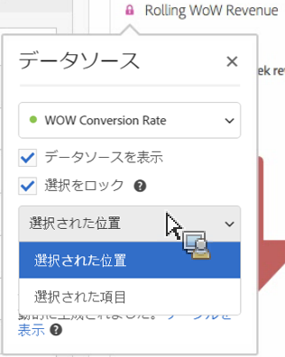

# データソースの管理 {#manage-data-sources}

>[!CONTEXTUALHELP]
>id="workspace_freeformtable_lockselection"
>title="選択をロック"
>abstract="この設定を有効にすると、ビジュアライゼーションがデータソースで選択した位置または選択した項目にロックされます。"

>[!CONTEXTUALHELP]
>id="workspace_freeformtable_lockselection_showtable"
>title="テーブルの表示"
>abstract="**[!UICONTROL テーブルを表示]**&#x200B;を選択すると、元のデータソースとは別に、現在のビジュアライゼーション用に新しいデータソースが生成されます。"

>[!CONTEXTUALHELP]
>id="workspace_freeformtable_showtable"
>title="テーブルの表示"
>abstract="「**[!UICONTROL テーブルを表示]**」を選択して、元のデータソースとは別に、現在のビジュアライゼーション用の新しいデータソースを生成します。"

Analysis Workspaceの各ビジュアライゼーションは、データソース（通常はフリーフォームテーブル）に基づいています。 ビジュアライゼーションを同期すると、どのフリーフォームテーブルまたはデータソースがビジュアライゼーションに対応するか、ビジュアライゼーションがそのテーブル内の特定の行にロックされたままであるかどうかを制御できます。

>[!TIP]
>
>ビジュアライゼーションのタイトルの横の  の色で、どのビジュアライゼーションが関連しているかがわかります。 色が一致していると、ビジュアライゼーションが同じデータソースに基づいていることを意味します。
>

<!--
**Tip:** You can tell which visualizations are related by the color of the dot next to the title. Matching colors mean that visualizations are based on the same data source.

Managing a data source lets you show the data source or lock the selection. These settings determine how the visualization changes (or doesn't change) when new data comes in.

1. [Create a project](/help/analyze/analysis-workspace/home.md) with a data table and a [visualization](/help/analyze/analysis-workspace/visualizations/freeform-analysis-visualizations.md).
1. In the data table, select the cells (data source) you want to associate with the visualization.
1. In the visualization, click the dot next to the title to bring up the **[!UICONTROL Data Source]** dialog. Select **[!UICONTROL Show Data Source]** or **[!UICONTROL Lock Selection]**.

   

   Synchronizing a visualization to a table cell creates a new (hidden) table and color-codes the synchronized visualization with that table.

>[!BEGINSHADEBOX]

See  [Data source settings](https://video.tv.adobe.com/v/23729?quality=12&learn=on){target="_blank"} for a demo video.

>[!ENDSHADEBOX]

-->

## データソースの設定 {#configure}

1. Analysis Workspaceで、設定するデータソースまたはロック設定のビジュアライゼーションに移動します。

1. ビジュアライゼーションにカーソルを合わせ、**[!UICONTROL 設定]** アイコン を選択します。

1. 「**[!UICONTROL データソース]**」タブを選択します。

   

1. 次のいずれかの設定を行います。

   | 設定 | 説明 |
   | --- | --- |
   | **[!UICONTROL データソース]** | ビジュアライゼーションの基となるデータソースを選択します。 |
   | **[!UICONTROL リンクされたビジュアライゼーション]** | データソース（フリーフォームテーブル）にリンクされているすべてのビジュアライゼーションを一覧表示します。 |
   | **[!UICONTROL データソースを表示]** | ビジュアライゼーションに対応するデータソース（フリーフォームテーブル）を表示または非表示にします。 |
   | **[!UICONTROL 選択範囲をロック]** | データソースで現在選択されている行にビジュアライゼーションをロックしてから、**[!UICONTROL 選択した位置]**&#x200B;または&#x200B;**[!UICONTROL 選択した項目]**&#x200B;を選択します。 [選択範囲をロック &#x200B;](#lock-selection)を参照してください。 |

## 選択をロック {#lock-selection}

選択範囲をロックすると、テーブルが変更されたときでも、データソース内で選択した行に焦点を当てたビジュアライゼーションが維持されます。 例えば、並べ替えやフィルタリング、日付範囲の変更、セグメントの適用などを行うと、テーブルが変更されます。 ロックされたビジュアライゼーションには、タイトルの横にが表示されます。

データソース内のセグメント、ディメンションまたは指標が変更され、ロックされたデータが表示されなくなった場合は、**[!UICONTROL テーブルを表示]**&#x200B;を選択して、元のデータソースとは別に、ビジュアライゼーション用の新しいデータソースを生成します。

選択範囲をロックする場合は、次のいずれかのオプションを選択します。

| オプション | 説明 |
| --- | --- |
| **[!UICONTROL 選択した職位]** | ビジュアライゼーションを、データソースで選択された行の&#x200B;**位置**&#x200B;にロックします。 それらの位置は、項目が変更されても、引き続き視覚化されます。 例えば、どのキャンペーンであるかに関係なく、データソースの上位5つのキャンペーン名を常に表示するには、このオプションを選択します。  分類の行をロックし、それらの行がテーブルに存在しなくなった場合、ビジュアライゼーションは表示されません。 もう一度表示するには、テーブル（日付範囲、セグメント、フィルターなど）を更新するか、ロック選択を更新します。 |
| **[!UICONTROL 選択した項目]** | データソースで選択された特定の&#x200B;**項目**&#x200B;にビジュアライゼーションをロックします。 テーブル内のランキングが変更されても、それらの項目は引き続き可視化されます。 例えば、ランクに関係なく、常に同じ5つのキャンペーン名を表示するには、このオプションを選択します。 |
